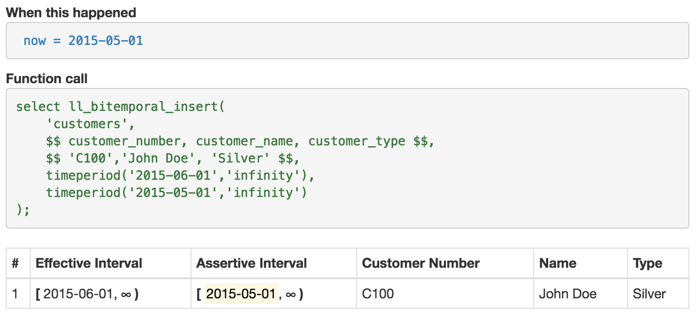
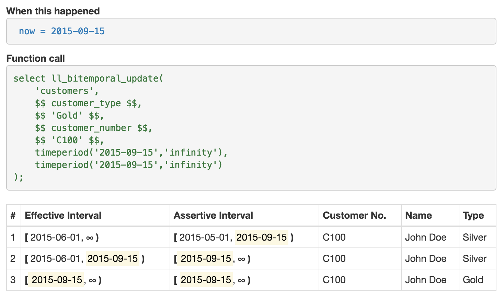
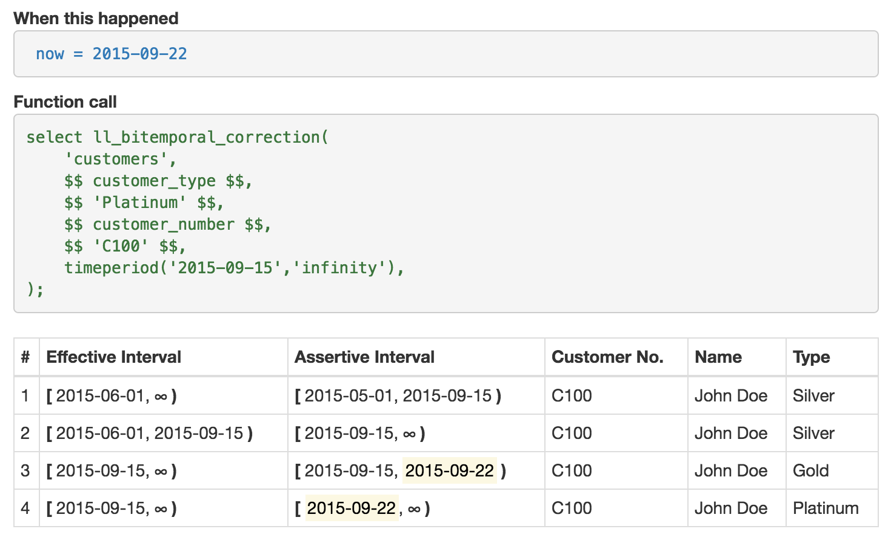
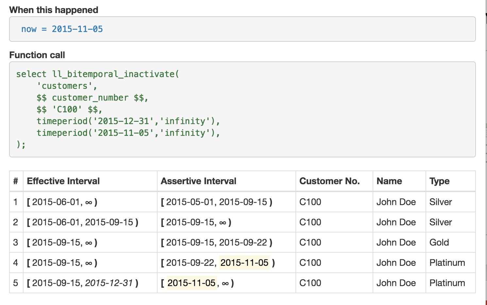
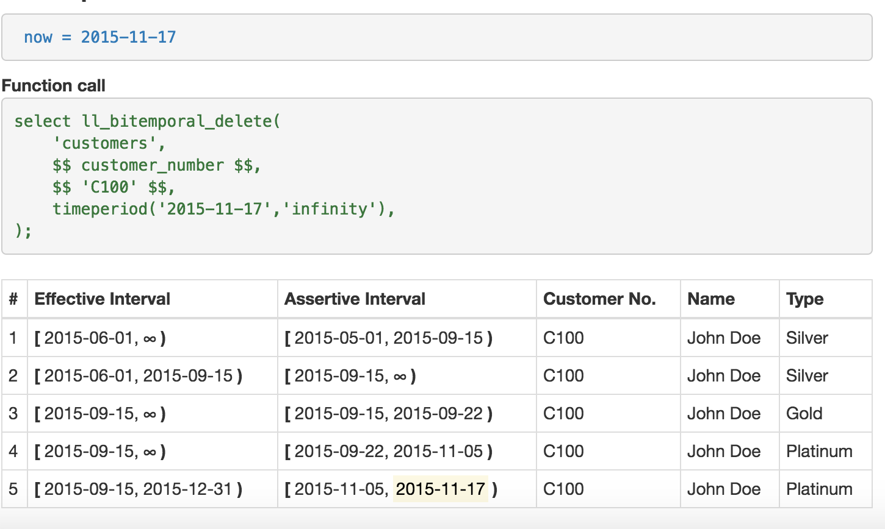

<!-- Slide number: 1 -->
# What’s New in PG_BITEMPORAL?
Hettie Dombrovskaya
Braviant Holdings, Chicago
Chad Slaughter
Scale Genius, Inc.

<!-- Slide number: 2 -->
# Bitemporal data: making it happen in Postgres
Incorporating time, thereby making the data models temporal, is a hot topic. Many systems are already providing this kind of support (DB2, Oracle) and it is included into the SQL ANSI 2011 standard.
However, Postgres never formally included the time dimensions, and we are going to fix this

<!-- Slide number: 3 -->
# References – these are the last year’s, should be updated
C.J. Date, Hugh Darwen, and Nikos Lorentzos. 2014. Time and Relational Theory, Second Edition: Temporal Databases in the Relational Model and SQL (2nd ed.). Morgan Kaufmann Publishers Inc., San Francisco, CA, USA.
Tom Johnston. 2014. Bitemporal Data: Theory and Practice (1st ed.). Morgan Kaufmann Publishers Inc., San Francisco, CA, USA.
Tom Johnston and Randall Weis. 2010. Managing Time in Relational Databases: How to Design, Update and Query Temporal Data. Morgan Kaufmann Publishers Inc., San Francisco, CA, USA.
Krishna Kulkarni and Jan-Eike Michels. 2012. Temporal features in SQL:2011. SIGMOD Rec. 41, 3 (October 2012), 34-43.
Richard Thomas Snodgrass. 1999. Developing Time-Oriented Database Applications in SQL. Morgan Kaufmann Publishers Inc., San Francisco, CA, USA.
ISO/IEC 9075-2:2011, Information technology — Database languages — SQL , 2011

<!-- Slide number: 4 -->
# Overview: what we did so far
The surveys (Kosman et al) indicate, that is should be easy to support time in Postgres due to the existence of the GIST indexes. And we’ve utilized this advantage.

Last year we presented the Postgres-based implementation of asserted versioning framework (Johnston and Weis). We implemented the Allen operations for the time intervals and all basic bitemporal operations

<!-- Slide number: 5 -->
# Where our work can be found
pg_bitemporal git repo
operations:
create bitemporal table
bitemporal insert
bitemporal update
bitemporal correction
inactivate
bitemporal delete
support of bitemporal constraints

<!-- Slide number: 6 -->
# Overview of bitemporal operations
The next several slides present the basic bitamporal data manipulation operations and explain the differences between bitemporal and conventional operations

<!-- Slide number: 7 -->
# Bitemporal Insert
now = 2015-05-01

| # | Effective Interval | Assertive Interval | Customer No. | Name | Type |
| --- | --- | --- | --- | --- | --- |
| 1 | [2015-06-01, oo) | [ 2015-05-01 , oo) | Cl 00 | John Doe | Silver |
select ll_bitemporal_insert(
'customers'f
, $$’customer_no’, name', ’type' $$,
, $$'C100','John Doe', 'Silver' $$,
 timeperiod('2015-06-01','infinity'),
timeperiod('2015-05-01','infinity')
Effective
Asserted

1

<!-- Slide number: 8 -->
# Bitemporal Update
now()=‘2015-09-15’
| # | Effective Interval | Assertive Interval | Customer No. | Name | Type |
| --- | --- | --- | --- | --- | --- |
| 1 | [2015-06-01, oo) | [2015-05-01,2015-09-15) | Cl 00 | John Doe | Silver |
| 2 | [2015-06-01,2015-09-15) | [2015-09-15, oo) | Cl 00 | John Doe | Silver |
| 3 | [2015-09-15, oo) | [ 2015-09-15, oo) | Cl 00 | John Doe | Gold |
select ll_bitemporal_update(‘customers’,
‘type’, ‘Gold’,
‘customer_no’, ‘C100’,
timeperiod(‘2015-09-15’, ;infinity’),
timeperiod(‘2015-09-15’, ;infinity’))

Effective
Asserted

1

1
3
2

<!-- Slide number: 9 -->
# Bitemporal insert
Asserted
Asserted

1

<!-- Slide number: 10 -->
# Bitemporal update

Effective
Effective
Asserted
Asserted

1
1
3
2

<!-- Slide number: 11 -->
# Bitemporal correction
Effective

Effective

Asserted

Asserted
1
1
3
2
3
2
4

<!-- Slide number: 12 -->
# Bitemporal inactivate

Effective
Effective
Asserted
Asserted

1
1
3
2
3
2
4
4
5

<!-- Slide number: 13 -->
# Bitemporal delete

Effective
Effective
Asserted
Asserted

1
1
3
2
3
2
4
4
5

5

<!-- Slide number: 14 -->
# Repo:

https://github.com/scalegenius/pg_bitemporal

<!-- Slide number: 15 -->
# How to define constraints
We need to support the following constraint types:
Primary key
Unique
Check – no difference from regular tables
IS/IS NOT NULL – no difference from regular tables
Foreign key
We use metacode to record the presence of the bitemporal constraints?

<!-- Slide number: 16 -->
# What we’ve done with constraints so far
PK: select bitemporal_internal.pk_constraint('postgres_cluster_id');
UQ: select bitemporal_internal.unique_constraint('port');
FK: why is it especially difficult?

<!-- Slide number: 17 -->
# Define foreign key constraint (bi-temporal referential integrity)
The difficulty of verifying the bi-temporal FK is that the PK/UQ in the parent table should be effective and asserted all the time when a dependent record is effective/asserted
 CONSTRAINT "bitemporal fk postgres_version_database_versionsrelease_version"      check (true or 'fk' <> '@postgres_version -> database_versions(release_version)@'));

Function:
select bitemporal_internal.fk_constraint(
'postgres_version’
,'database_versions’
,'release_version');

<!-- Slide number: 18 -->
# FK constraint validation internals
What happens, when a new FK is being created:

bitemporal_internal.ll_add_fk(
	p_schema_name text,
	p_table_name text,
	p_column_name text,
	p_source_schema_name text,
	p_source_table_name text,
	p_source_column_name text)
returns text

<!-- Slide number: 19 -->
# FK creation steps
Check whether the referencing field is a PK/UQ
validate_bitemporal_pk_uq
Create check constraint
fk_constraint
Check whether the validation on the parent table field already exists
ll_lookup_validation_function
If not, create it
ll_generate_fk_validate
create trigger on insert/update and a trigger function

<!-- Slide number: 20 -->
# Start of new material
The previous slide was the last slide of the “review”. The next 11-15 slides should describe a new approach and algorithm

<!-- Slide number: 21 -->
# Understanding Bi-Temopral Queries

<!-- Slide number: 22 -->
# Time Dimensions in Query Results
Snapshot queries
X=10 at a point in 2-D time
TRUE or FALSE at any time
Interval queries in selection criteria
What is the value of X in a 2-D time region?
May return multiple rows with time regions
One-dimensional conditions are allso here
Implicit time conditions
Temporal join: R.a=S.a
Values are equal only at time when they are valid in both R and S

<!-- Slide number: 23 -->
# Specifying Query Elements
Conceptually each row has associated  2-D time region
The strategy is to perform an operation as in non-temporal DB and calculate region for each tuple of result
Operations on time regions:
∩ - intersection
∪ - union
∖ difference
Examples:
Interval query: intersect query region with tuple regions
Join: find mathcing tuples and intersect their regions

<!-- Slide number: 24 -->
# Updates are Tricky
UPDATE a_table SET attr = (expr) WHERE (cond)
Time regions for:
S – the UPDATE statement (for new values to be set)
P -a row with old values (to be updated)
N- a rwo with new valuses (empty of not exists)
P ⋂ N = ⍉
After UPDATE the DB wil contain regions:
Old values: P ∖ S
New values: N  ∪S

<!-- Slide number: 25 -->
# Time Regions
Operations on time regions:
∩ - intersection
∪ - union
∖ difference
Asserted inerval × Effective interval = rectangle
Unfortunately, union and difference are of rectengles are not rectangular
Sets of non-intersecting rectangles: all operationas produce sets or rectangles

<!-- Slide number: 26 -->
# Conceptual Representation: Nested Relational
Each row contains a cuboid set
DB primar key is the entire non-temporal row
(business key, non-key attributes)
DB foreign keys are unsuable
Updates affect at most 3 rows
| (business) key | Non-key attributes | Cuboid |  |
| --- | --- | --- | --- |
|  |  | dim1 | dim2 |
| Alice | 10 | 1,10 | 1,100 |
| Alice | 15 | 10,20 | 1,100 |
| Bob | 9 | 1,5 | 1,30 |
|  |  | 5,10 | 50,100 |
| Bob | 16 | 10,20 | 30,100 |

<!-- Slide number: 27 -->
# Current PG Implementation: Flat Relational
DB primary key
( busines key, rectangle)
PK uniqueness can be supported with indexes
DB foreign keys are unusable
Updates amost always affect several rows
| (business) key | Non-key attributes | Cuboid |  |
| --- | --- | --- | --- |
|  |  | dim1 | dim2 |
| Alice | 10 | 1,10 | 1,100 |
| Alice | 15 | 10,20 | 1,100 |
| Bob | 9 | 1,5 | 1,30 |
| Bob | 9 | 5,10 | 50,100 |
| Bob | 16 | 10,20 | 30,100 |

<!-- Slide number: 28 -->
# What we found during implementation
The next six slides are from the last year presentation. I am leaving them for now, but they all should be replaced with the new ones, highlighting the new approach. I will try to add more later.

<!-- Slide number: 29 -->
# Future work
